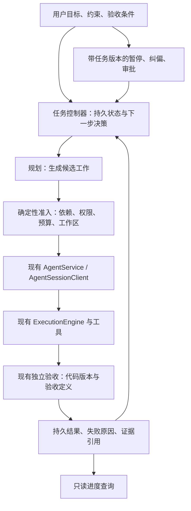

# ARTEX 工作流借鉴与无人值守改造设计

日期：2026-10-22。状态：用户已确认设计及第一批范围，进入具体实施计划；尚未修改运行代码。第二至第四批仍为后续方向，不属于本批实施范围。

## 1. 目标与研究范围

用户希望从本地 ARTEX 源码选取优良架构，改进本项目的无人值守 coding agent，保持结构清晰，避免堆叠互不衔接的功能。

本设计将成功标准落在实际行为上：长任务知道上一步为什么失败；进程重启不会重置进度和重试预算；依赖未满足不会派发；只有与当前代码及验收定义匹配的证据可以证明完成；暂停、审批和未知副作用不会被自动续跑绕过。

研究基线：

- 当前项目：`ecef84ac4599906810167b051d9dfc570144ce82`，研究开始时工作区无改动。
- ARTEX 实际源码根目录：`C:/Users/zhhqzs/Desktop/基座/artex-0.3.15(1)/ARTEX-main/ARTEX-main`，比用户给出的目录多一层 `ARTEX-main`。
- ARTEX 是 Go 后端、Next.js 界面、PostgreSQL 存储的自主渗透测试系统；本次只研究通用任务编排、知识管理、恢复和验收机制。
- 本地 ARTEX 的 `LICENSE` 为 AGPL-3.0。后续采取独立的 TypeScript 实现，不复制其源码、提示词或界面。
- 本次未启动 ARTEX、数据库或扫描工具，未安装依赖，也未运行其 Go 测试。它调用的 `github.com/Autumn-27/norma` harness 不在此次所读源码范围内；有关 SDK 的注释不能替代底层运行证据。

## 2. 核心判断

最值得引入的是任务控制层：根据已持久化的结果决定下一步，围绕同一目标持续推进。

本项目已有较强的执行保障：AgentService 的会话和事件记录、版本绑定的独立验收、工作区写入互斥、操作恢复、权限与预算控制。ARTEX 的优势在于把规划、工作队列、共享知识、运行干预接成长期闭环。两者应在任务控制边界结合。

规划者可以提议工作、解释结果，不能直接把任务标成已验收。确定性控制器拥有状态转换、预算、依赖和停止决定。

## 3. 从 ARTEX 学什么，以及实现边界

下列 ARTEX 路径均相对上述源码根目录，行号以本次所读副本为准。

| 机制 | 源码事实 | 适配本项目的做法 |
| --- | --- | --- |
| 规划与执行分开 | `server/engine.go:809` 的 plannerLoop 消费事件；worker 执行后写状态并通知 planner。`agent/mainagent.go:112` 单独处理用户对话 | 规划决策与单次模型工具循环分开，先复用现有执行服务 |
| 任务与工作项分层 | `server/goals.go:172` 统一准入；`db/exploration.go:1173` 条件领取意图；终态区分 done、blocked、exhausted、stopped | 任务记录与执行尝试分开，持久记录哪个工作由哪个 attempt 领取 |
| 事件驱动再规划 | `server/manager.go:1749` 记录具体变化；`server/engine.go:809` 默认约 800 ms 固定窗口合并，最短 600 秒心跳复查 | 先落盘再消费事件，以事件序号去重；心跳优先检查状态，不能每次无条件调用模型 |
| 稳定工作身份 | `agent/worker.go:474` 按意图恢复 transcript，人工消息有 request ID | 任务、attempt、thread、turn 分别有身份；恢复先检查执行收据，不能盲目重放 shell |
| 共享事实与证据 | `agent/tools.go:1306` 区分事实、证据、置信度；`db/exploration_sources.go:20` 提供有来源的一跳只读继承 | 保存约束、决策、失败尝试、验收和产物引用，限制任务范围与版本 |
| 活跃知识优先 | `agent/coldgraph.go:84` 保留活跃意图祖先和新产出；`agent/compaction.go:68` 折叠冷分支；原节点可展开 | 保留当前工作及依赖原文，摘要已结束分支；摘要不能替代原始验收证据 |
| 分阶段收尾 | `agent/wrapup.go:156` 区分本轮耗尽与整任务超时；worker settlement 禁用 Bash | 预算预先保留收尾份额，收尾只允许保存结果；人工取消立即停止新调用 |
| 旁路问答 | `sidequestion/service.go:11` 只做独立 completion，不持有主任务工具执行器 | 先提供确定性状态查询；后续可增加无工具的解释会话，修改目标仍走正式控制事件 |

以下能力不能按宣传或提示词描述直接认定已经保证：

1. **不是严格依赖调度器。** `db/exploration.go:1136` 按 open、priority、id 领取，没有依赖就绪判定。`agent/planner.go:43` 的待办是内存 map；串行链主要依赖规划者判断。
2. **有证据节点不等于验收成立。** `agent/tools.go:1157` 的 prove_goal 检查节点类型和归属，实际是否满足目标仍由模型判断；链接和状态更新错误还存在被忽略的路径。我们应保留现有独立测试及产物版本检查。
3. **触发队列并非全部持久可靠。** `server/conversations.go:610` 的自定义代理队列在内存中，触发水位另行保存；不能据此声称宕机不会漏事件。`db/triggers.go:194` 用任务 ID 推进超时事件水位，旧任务晚超时可能漏报。
4. **收尾不等于严格总耗时上限。** `server/engine_timeout.go:232` 的最终规划等待模型恢复没有独立上限。我们必须让收尾、重试和等待都服从总期限。
5. **持续产生工作不等于持续取得进展。** “无活跃工作就至少生成一个”是 `agent/planner.go:457` 的提示要求。通用 coding agent 需要允许明确阻塞，避免同义任务和相同错误反复消耗预算。

## 4. 当前项目的对应缺口

| 当前实际链路 | 已有能力 | 缺口与影响 |
| --- | --- | --- |
| `src/core/loopEngine.ts:37` | 冻结目标与验收定义、最大轮数、取消、独立验收 | 第 86 行每轮直接 runTurn 且历史为空；验收输出没有注入下一轮，也没有持久 attempt 游标 |
| `src/core/goals.ts:26` | Goal/SubTask 记录与命令工具 | 没有依赖、领取身份和验收引用；getNextSubtask 没有进入 engine/loop；completeGoal 可直接改 completed |
| `src/commands/automationCommands.ts:111` | 手工执行 workflow、递归调用保护 | 只提供 runSlash；agent/prompt 步骤未接真实 runner；vars 替换仍是占位实现 |
| `src/core/cron.ts:400` | 时间表达式与到期任务计算 | getDueTasks/markTaskRun 没有生产调度调用；配置成功不能代表会实际自动执行 |
| `src/core/agentService.ts:197` | 单线程 turn 排他、持久事件、steer、interrupt、结果与历史保存 | Loop 直接调用 engine，未统一进入这些服务控制；start 当前随机生成 turnId，没有跨提交的业务幂等键 |
| `src/tools/agent.ts:315` | 子代理权限隔离、工作区互斥、worktree、独立验收、取消 | 缺任务级结构化输入和持久 worker 身份；不能把一次性 child 当作可恢复工作队列 |

应继续保留的能力：

- `src/core/engine/acceptance.ts:27` 与 `src/core/verification.ts`：独立检查、验收定义哈希、产物版本、检查后的再次核对。
- `src/core/runContext.ts`、`workspaceLease.ts`：写入互斥与未结资源隔离。
- `src/core/operationRecovery.ts:45`：不确定副作用先协调，不能因为任务要继续就重复执行。
- `src/core/agentEventStore.ts`：可追溯事件、完整 turn 检查点、损坏与中断的显式状态。
- `src/core/modelGateway.ts`、`budget.ts`：主任务和子代理共享预算约束。

## 5. 选择的改造方式

三种可行方向：

1. **推荐：在现有执行内核上增加薄任务控制层。** 分批补齐失败反馈、持久尝试、任务依赖和事件唤醒。直接复用已有权限、预算、验收与进程生命周期。
2. **仅改规划提示词与代理预设。** 改动小，可以帮助模型分工，但无法补齐宕机恢复、可靠触发和依赖校验，不能满足本次目标。
3. **建立完整服务端任务平台。** 可以支持多用户、大规模并发和可视化管理，但当前会同时增加服务部署、数据库、第二套生命周期和维护成本。现阶段不采用。

第一批以现有 `--loop` 为产品入口，解决能够独立验收的闭环问题。暂不同时建设 Web 控制台、全局 daemon、数据库和通用图框架。

## 6. 第一批：让现有 Loop 从失败中学习，并保留可恢复进度

### 6.1 行为约定

- 保持 `.loop/GOAL.md`、`.loop/ACCEPTANCE.md`、现有 CLI 参数和退出状态兼容。
- 每轮提交前持久保存 attempt 身份、目标/验收版本、已消耗轮数；执行结束后保存模型结果、产物版本和验收结果；保存成功后才允许进入下一轮。服务的 turn.finished 只表示一次执行结束，不代表整个 Loop 通过验收。
- 下一轮必须获得上一轮失败检查的命令、退出状态、受控长度的输出、尝试次数及是否有代码变化。它们来自执行记录，不能依赖模型自行维护 STATE.md。
- 不直接把全部旧聊天作为新一轮输入。仅在客户端空闲时通过 replaceModelWindow() 安装任务快照与相关结果投影，保留 canonical history；不得通过 replaceHistory() 裁剪历史。投影不携带旧 provider continuation，沿用现有一致性校验。
- 只有同一 artifactVersion、definitionHash、任务目标版本的独立验收成功，才可完成任务。检查通过后代码变化会使验收失效。
- 连续三次出现相同失败检查指纹且产物版本不变，进入 blocked，附明确原因。次数写入状态，重启不能绕过。上限是第一版默认，可由任务配置显式调整。
- 停滞指纹至少包含失败命令身份、退出状态与归一化诊断；不使用原始时间戳或进程号。进展比较排除明确的控制器状态、日志和模型进度笔记，不能靠反复改写 STATE.md 重置停滞计数；项目代码与用户产物仍需纳入，不能把整个未跟踪文件集合排除。
- 验收失败且仍有变化时，可以在已有总轮数与模型预算内继续修复。模型供应商的网络重试仍由现有 gateway 负责，不再增加一层无限模型重试。
- needs_input、权限拒绝、工作区隔离、未知副作用直接停止自动推进；不能当成一般测试失败重试。
- 失败分类必须来自宿主产生的结构化原因或审批事件：当前部分权限/预算拒绝会退化成普通 failed，需要补齐这一接缝，不能匹配错误文案判断。优先保留 cancelled、interrupted、needs_input、恢复要求和限额结果；只有明确的可修复验收失败才自动再试，未分类错误保留 failed。
- 人工取消不触发新的模型收尾轮；只做有界的本地持久化和既有资源清理。
- 接入 service 后显式采用现有每 turn 10 分钟期限及有界清理；这比直接 engine Loop 多一个限制，需在 CLI 提示并覆盖超时测试。第一批不新增任务级总 Token/费用账户，仍使用项目预算和未结 reservation。

### 6.2 模块边界

建议新增 `src/core/autonomy/`，第一批只实现有实际调用的三个职责：

- `attemptStore.ts`：任务版本、attempt 状态、执行/验收引用、剩余轮数与停滞计数。使用现有持久化锁与原子文件模式；不得向全局 goals.json 塞入整段历史。
- `continuation.ts`：纯决策函数，返回 continue 或现有 OutcomeStatus，包括 failed、cancelled、interrupted、blocked、needs_input、completed、limit_reached；不调用模型或 shell，停止原因优先于修复重试。
- `context.ts`：将失败记录和任务事实投影成有界模型输入；证据保留引用和截断标识。

`loopEngine.ts` 保留兼容入口，负责串接这些模块；Loop 的真实 turn 执行改接现有 AgentSessionClient/AgentService。当前 Loop 分支尚无绑定客户端：由 CLI 为该分支创建唯一客户端，调用既有 bindClient 后注入 Loop，统一中断和清理，避免同一 session 同时被两个 service 持有。

当前 `--bg` 要求 task，且不转发 Loop/恢复参数。第一批验收前台 `--loop`，只回归原有后台单任务兼容；不把后台 Loop 当作已经存在的入口。后台 Loop 的参数转发、恢复身份和监督器集成放入第二批。

控制器运行数据放在会话专属目录，由具体文件排除规则从代码产物哈希中排除；不能笼统排除整个项目状态目录。GOAL/ACCEPTANCE 继续冻结与核对，模型可以编辑的 STATE.md 不作为可信控制状态。

### 6.3 恢复边界

第一批保证“完整检查点之间恢复”，不承诺任意指令位置的自动接管：

1. 绑定相同 canonical workspace、目标哈希和验收定义哈希。
2. 检查任务账本、服务事件和 operation recovery 状态。
3. 完整已结束 turn 且持久验收已记录时，恢复已消耗轮数和下一步决定。复用成功证据前必须在工作区所有权保护下复核当前产物、验收定义与目标版本；外部代码变化会使旧成功证据失效。只有仍有效的工作才可跳过。
   第一批的恢复入口使用 `--loop --resume <session>`，或经验证最新会话确实包含匹配 Loop 账本的 `--loop --continue`；普通新建 Loop 创建独立任务记录。继续时沿用旧记录的轮数上限和已消耗次数，命令行不能无提示覆盖；项目模型费用/Token 额度及未结 reservation 继续由现有 budget 存储负责，控制器不维护第二套账。
4. 发现已派发但未持久记录终态、未知写入结果或活动进程所有权不明确时，进入恢复要求，沿用现有恢复流程。
5. 当前 AgentService.start 没有业务幂等键；不能用“相同 prompt 再调用一次”补偿丢失应答。跨提交可靠重放由第二批补足。

检查点提交顺序：`prepared → dispatched（绑定 turnId）→ settled（服务终态）→ checkpointed（控制器验收与决定）`。prepared 在锁内预占一次轮数并写入 attempt；提交应答丢失时该轮仍计入，不能假定未执行。settled 与任务完成是不同事实。最终验收收据及状态必须在工作区所有权保护下提交，持久化失败不发布任务成功。发现 prepared/dispatched/settled 未形成完整检查点时，第一批保守进入恢复要求，不自动补投、退还轮数或跳过验收。

### 6.4 第一批验收用例

1. 第一轮验收失败，第二轮实际收到失败命令、退出状态与输出摘要，并据此修复后通过。
2. 同错误且文件未变连续达到阈值时停止；错误变化或有效产物变化按规则重新计数。
3. 完整检查点后重启保留已消耗轮数、停滞次数及失败记录，并继续受既有项目预算及未结 reservation 约束；不能重置为第 1 轮。
4. 写文件后但收据前中断，恢复不重复执行，不提前标成功。
5. 目标或验收定义被改写、仅伪造 DONE.flag、测试通过后产物被改写，都不能完成。
6. needs_input、用户明确拒绝审批、预算准入拒绝、未消费 steering、审批断开、取消、资源未结均保持明确原因，不自动重试；每 turn 服务期限到达后停止派发并有界清理。
7. 超长失败输出被截断且可定位原记录；不把内部 reasoning、凭据或 provider continuation 注入任务共享状态。
8. CLI 的前台 `--loop` 与指定会话恢复路径运行真实本地夹具，回归原有后台单任务；模拟服务数据只能补充，不能代替入口验收。
9. 检查点后退出、外部修改代码再恢复，旧完成凭据失效，不能跳过重新验收。
10. 在“下一轮已预占、提交结果未知”和“服务已完成、attempt 终态未保存”两个故障点重启，不重复提交，不退还已预占轮数，明确要求恢复。

## 7. 后续批次及依赖

### 第二批：一个任务账本、一条事件入口

- 将 Goal/SubTask 映射为项目内任务契约，加入依赖、attempt、输入版本和验收引用；旧全局 Goal 数据不自动赋予执行权，显式选择后导入并保留来源。
- 只有所有必要前置已验收，工作项才可领取。依赖循环、失效证据和重复领取在代码层拒绝。
- 使用 `taskId + revision + eventSequence` 的持久事件入口。事件状态变更与待消费记录原子保存，确认消费后才推进水位；不能使用任务创建 ID 代替事件 ID。
- 给服务提交增加有边界、可恢复的幂等身份，并将该身份写入启动事件；同键不同输入必须拒绝。只有这个接缝验收后才开放宕机后的自动补投。
- 先接任务完成、验收失败与人工修正，再接 cron。调度器重启不会重放已消费事件，忙碌时有界排队，模型不可用时保留待处理状态。
- 接通后台 Loop 的启动、参数转发及恢复身份，使 detached supervisor 跑同一任务控制器；不能仅把 `--bg --loop` 两个标志拼在一起即宣称支持。
- 相同工作区写操作继续串行；不同 worktree 的并发沿用现有产物验收与合入约束。

### 第三批：规划、共享事实与受控纠偏

- 规划者只输出结构化候选工作，记录预期产物、依赖、验收引用、预期输入版本。控制器验证后再执行。
- 小型任务事实账本保存观察结果、推断、负面结果、约束与来源；推断不能直接升级成已验收事实。
- worker 只获得相关子任务的上下文。前序结果改变后，新任务使用新版本，旧 worker 的结果不能覆盖新计划。
- 显式记录停止原因：用户暂停、用户取消、模型限额、供应商暂不可用、审批等待、执行失败、停滞。沿用 service 的 steer/interrupt 能力，不另建一套弱取消通道。
- 目标完成的代码判定继续复用验收；模型不能通过调用一个 complete 工具绕过它。人工覆盖必须单独标记为人工决定，不能展示成测试验收通过。

### 第四批：按任务结构管理上下文，完善旁路观察

- 活跃任务、依赖输入、约束和未解决失败保留原文；已结束分支按需要摘要，并保留可展开的原记录及版本。
- 先实现结构化进度查询，再评估无工具的模型解释会话；旁路问答不得修改主任务记录。
- 收尾预算从总预算内预留，所有收尾能力在代码层限制；总时间或费用限额不可被额外收尾轮突破。
- 工具按需加载和模型池健康策略在已有能力对照后再决定，避免复制两套资源注册与重试逻辑。

## 8. 验证与交付证据

2026-10-22 在当前项目运行以下现有基线检查：

`node node_modules/vitest/vitest.mjs run tests/loopOutcome.test.ts tests/core/loopAcceptanceAtomicity.test.ts tests/core/loopWorkspaceAudit.test.ts tests/agentVerification.test.ts tests/core/agentEventStore.test.ts --maxWorkers=2`

结果：5 个测试文件、47 项通过，退出码 0，8.60 秒。证明所覆盖的 Loop 验收、工作区约束、子代理验收和事件存储基线通过；不代表已经实现本设计，也不代表 ARTEX 或真实模型的任务成功率已验证。

设计阶段交付为源码比较和设计文档。用户随后确认第一批，实施计划见 `docs/superpowers/plans/2026-10-22-artex-loop-controller.md`。截至计划编写时，尚未修改产品源码、执行数据库迁移、启动定时任务或增加依赖。

后续实现以本设计第一批验收为边界，完成后再决定进入第二批。每批必须用实际 CLI/服务调用链证明接通，记录验证范围，并检查与上一批模块的接口衔接。
